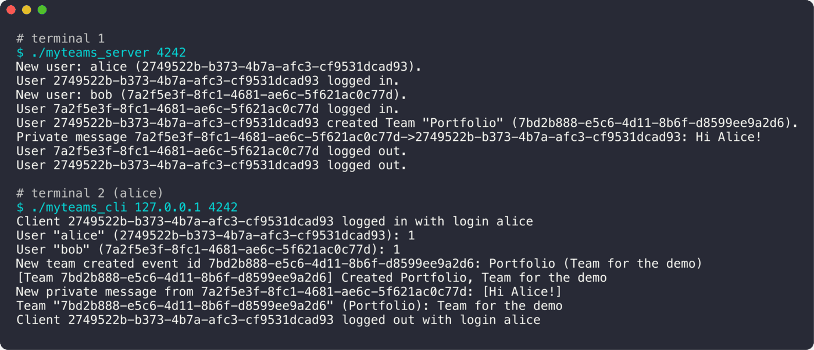

<div align="center">

# myTeams

**Microsoft Teams en ligne de commande : un serveur, des clients, des équipes et des messages.**

  

<sub>Projet à 3 · 2024</sub>

</div>

<br/>

<p align="center"></p>

## En deux mots

Un serveur et un client en C pour discuter comme sur Teams : on se connecte, on crée des équipes, des canaux et des fils de discussion, on s'envoie des messages privés. Tout est sauvegardé et revient au redémarrage du serveur.

## Ce que ça fait

- Serveur TCP **multi-clients**
- Utilisateurs, équipes, canaux, fils de discussion, réponses et **messages privés**
- Abonnements aux équipes (`/subscribe`) et notifications en temps réel
- **Protocole** client / serveur conçu par l'équipe et documenté dans [protocol.md](protocol.md)
- **Sauvegarde** de toutes les données et restauration au redémarrage

## Sous le capot

Le serveur multiplexe les clients, parse les commandes (`/login`, `/create`, `/send`…) et répond selon le protocole commun. Chaque entité a un UUID. À l'arrêt, tout est écrit dans des fichiers, et le serveur recharge l'état au démarrage.

## Lancer le projet

```bash
make
./myteams_server 4242
./myteams_cli 127.0.0.1 4242
/login "alice"
/create "Portfolio" "Team for the demo"
```

## L'équipe

<a href="https://github.com/Wilson-Epitech/myteams/graphs/contributors"></a>

Marius Rousset, Edouard Bocquet, Wilson Bordichon

**Ma part :** J'ai fait toute la **persistance** : l'architecture du dossier `database/`, la création automatique des fichiers, la sauvegarde des utilisateurs, équipes, fils et réponses, et leur rechargement au démarrage du serveur.
